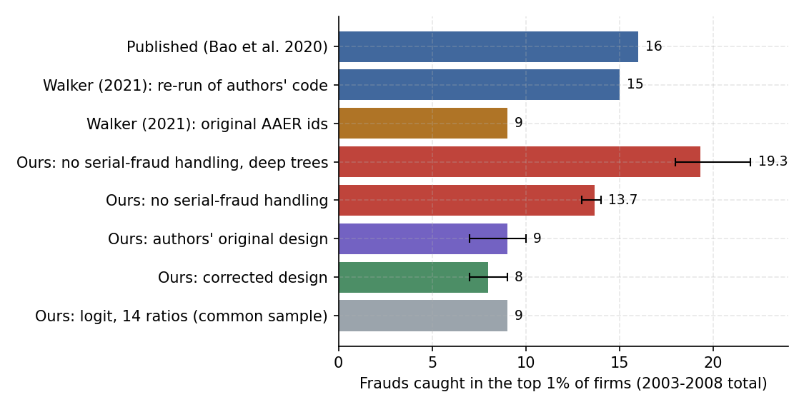

# Replicating Bao et al. (2020): Machine Learning, Leakage, and Accounting Fraud Detection

A full Python replication of

> Bao, Y., Ke, B., Li, B., Yu, Y. J., & Zhang, J. (2020). Detecting accounting fraud in publicly traded U.S. firms using a machine learning approach. *Journal of Accounting Research*, 58(1), 199–235. Erratum, *JAR* 60(4), 2022.

together with the serial-fraud critique of Walker (2021, *Econ Journal Watch*). The full write-up is in [`docs/REPLICATION_REPORT.md`](docs/REPLICATION_REPORT.md).



## Key findings

1. **The corrected design replicates.** RUSBoost on 28 raw financial items catches 8 frauds (7–9 across seeds) in the top 1% over 2003–2008, consistent with Walker's 9.
2. **The evaluation is validated against the authors' own output.** Re-scoring the authors' published predictions reproduces the published 16 hits exactly (8, 4, 2, 1, 1, 0 by year).
3. **Leakage is large and grows with model capacity.** Without serial-fraud handling, hits rise from 8 to 13.7; with unrestricted trees they reach 19.3, above the published figure. Under the corrected designs, deeper trees bring no gain.
4. **The published gains are traced case by case.** 10 of the 16 published hits come from 20 test-year frauds whose training years were not recoded because of split case identifiers. These cases are 8% of test-year frauds but are caught at a 50% rate, against 2.5% for all others (Fisher *p* ≈ 3.5 × 10⁻⁹). Net of leakage, the published model and this implementation detect fraud equally well.
5. **The ratio benchmark is not beaten.** On a common sample, a Dechow et al. (2011)-style logit on 14 ratios catches as many frauds in the top 1% as any machine-learning model; RUSBoost wins only on AUC.
6. **Most test-year frauds are already under way.** 54% of test-year frauds continue cases that began in the training window; only 1–3 of 121 genuinely new frauds reach the top 1%.

## Repository structure

```
├── config.py                  sample periods, hyper-parameters, reference checkpoints
├── src/
│   ├── data.py                loading, checks, inf handling
│   ├── metrics.py             AUC, NDCG@k, precision@k, sensitivity@k
│   ├── serial.py              five serial-fraud schemes
│   ├── models.py              RUSBoost (Python re-implementation), logit, GBM
│   └── experiment.py          rolling out-of-sample experiment (parallel)
├── scripts/
│   ├── 00_make_synthetic_data.py   synthetic file for testing the pipeline
│   ├── 01_check_data.py            data check against published counts
│   ├── 02_replicate.py             main replication
│   ├── 03_serial_fraud.py          serial-fraud schemes (--leaves, --trees for capacity)
│   ├── 04_extension_gbm.py         GBM and ratio features
│   ├── 05_tune_rusboost.py         tuning the number of trees (with serial-fraud handling)
│   ├── 06_interpret.py             permutation importance
│   ├── 07_collect_results.py       results/REPORT.md
│   ├── 08_compare_published.py     comparison with the authors' published predictions
│   ├── 09_memorization_check.py    hits split into continuing vs new frauds
│   ├── 10_leak_categories.py       case-level decomposition of hits
│   └── 11_make_report_figures.py   report figures from results_summary/
├── results_summary/           archived summary tables behind every number in the report
├── docs/
│   ├── REPLICATION_REPORT.md
│   └── figures/
├── run_all.ps1 / run_all.sh   full pipeline (Windows / Unix)
└── data/                      not tracked: download as below
```

## Setup

```bash
python -m venv .venv
.venv\Scripts\activate            # macOS / Linux: source .venv/bin/activate
pip install -r requirements.txt
```

`lightgbm` is optional; without it, GBM falls back to scikit-learn's `HistGradientBoostingClassifier`.

## Data

The data are distributed by the original authors at <https://github.com/JarFraud/FraudDetection> and are not redistributed here.

```powershell
git clone https://github.com/JarFraud/FraudDetection.git
Copy-Item FraudDetection\data_FraudDetection_JAR2020.csv data\

# Older file with new_p_aaer, and the authors' published predictions, from the repository history
cd FraudDetection
git restore --source=b2995bf uscecchini28.csv
git restore --source=20c9d80 prediciton_rusboost28_2003-2008.zip
Copy-Item uscecchini28.csv ..\data\
Expand-Archive prediciton_rusboost28_2003-2008.zip -DestinationPath ..\data\published_predictions
cd ..
```

On Windows, use `git restore` rather than PowerShell redirection (`>`), which writes UTF-16 files.

## Running

```powershell
python scripts/01_check_data.py                                                   # data check
python scripts/02_replicate.py --data data/uscecchini28.csv --seeds 3 --jobs -1  # main results
python scripts/03_serial_fraud.py --data data/uscecchini28.csv --seeds 3 --jobs -1             # serial fraud
python scripts/03_serial_fraud.py --data data/uscecchini28.csv --seeds 3 --jobs -1 --leaves 0  # deep trees
python scripts/04_extension_gbm.py --seeds 3 --jobs -1 --common-sample             # model comparison
python scripts/05_tune_rusboost.py --data data/uscecchini28.csv --seeds 3          # tuning
python scripts/08_compare_published.py --data data/uscecchini28.csv --ours         # vs. published scores
python scripts/09_memorization_check.py --data data/uscecchini28.csv --ours        # continuing vs new frauds
python scripts/10_leak_categories.py --data data/uscecchini28.csv --ours --seeds 3 # case-level decomposition
python scripts/11_make_report_figures.py                                          # report figures
```

Every run writes to `results/` and overwrites it; rename the folder after each experiment (`Rename-Item results results_<name>`). For a quick end-to-end test, add `--trees 300`, or generate synthetic data with `scripts/00_make_synthetic_data.py` and pass `--data data/synthetic_test.csv`.

## Design notes

- **RUSBoost.** Re-implemented in Python following Seiffert et al. (2010): each round keeps all frauds, draws an equal number of non-frauds at random, fits a small tree with the current boosting weights, and updates the weights on the full training set using an AdaBoost.M2-style pseudo-loss. Learning rate 0.1, 3,000 rounds, at least 5 observations per leaf, at most 11 leaves (an assumption about Matlab's boosting default). Results are close to, not identical with, Matlab's.
- **Sample split.** For each test year *t* = 2003–2008, train on 1991 to *t* − 2 and test on *t*.
- **Randomness.** Results are reported as means and ranges over three seeds, because six test years yield only 7–19 hits.
- **Known limitations.** Detection bias in AAER-based labels; look-ahead bias from AAER release timing; the SVM-FK benchmark is not implemented.

## Citation

If you use this code, please cite the original paper and Walker (2021), and refer to this repository:

> Zhang Qi (2026). Replication of Bao et al. (2020): Machine learning, leakage, and accounting fraud detection. GitHub repository, https://github.com/ZQ-77777/Bao2020-Fraud-Detection-Replication.

## Author

Zhang Qi
