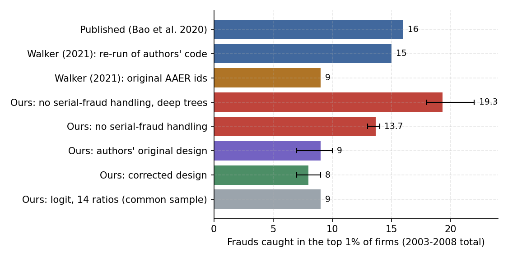
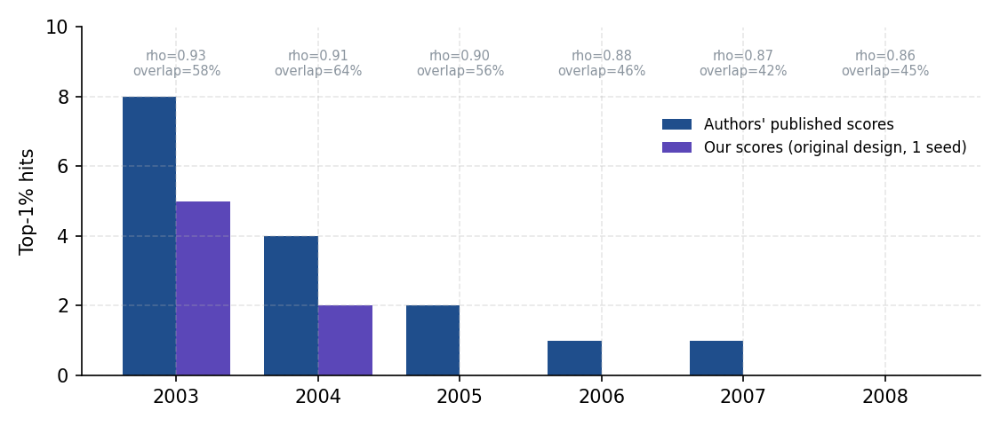
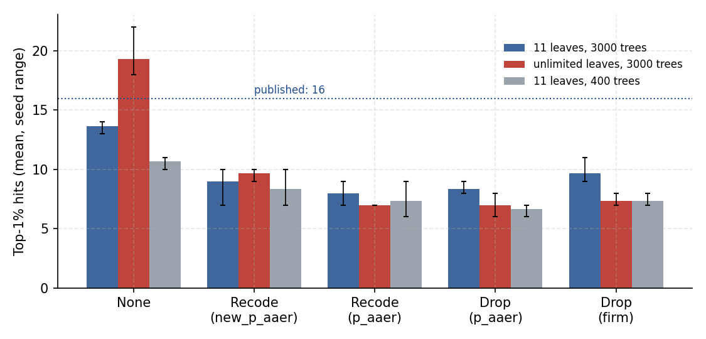
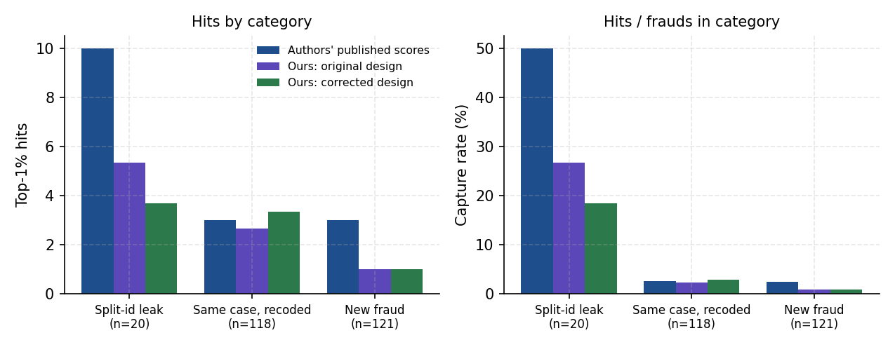
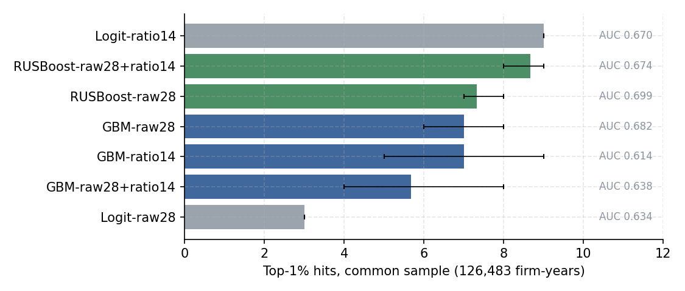
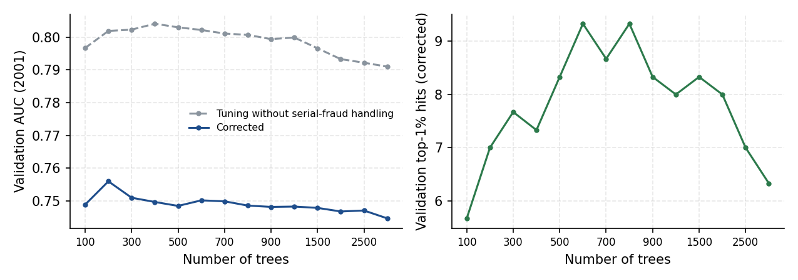

# Leakage, Memorization, and the Detection of Accounting Fraud: A Replication of Bao, Ke, Li, Yu and Zhang (2020)

**Zhang Qi**
November 2026 · Code: <https://github.com/ZQ-77777/Bao2020-Fraud-Detection-Replication>

---

## Abstract

Bao et al. (2020, *Journal of Accounting Research*) report that an ensemble learner (RUSBoost) trained on 28 raw financial statement items detects accounting fraud out of sample better than ratio-based benchmarks: over 2003–2008, 16 of the firms ranked in the top 1% by the model were subject to SEC enforcement for those years. Walker (2021) showed that the authors' code failed to fully separate serial frauds across training and test periods, and the authors issued an erratum (2022). I re-implement the full pipeline in Python using the authors' public data and verify the evaluation by re-scoring the authors' published predictions, which reproduce the 16 hits exactly. Under the corrected design, RUSBoost catches 8 frauds (7–9 across seeds) and does not outperform a Dechow et al. (2011)-style logit on the top-1% list. Three further analyses explain where the published gains came from. First, leaving serial frauds unhandled inflates hits by about 70%, and the inflation grows with model capacity: with unrestricted trees, hits reach 19, above the published figure. Second, a case-level decomposition shows that 10 of the 16 published hits come from 20 test-year frauds whose earlier years were not recoded because of split case identifiers; these cases represent 8% of test-year frauds but are caught at a 50% rate, against 2.5% for all others (Fisher exact *p* ≈ 3.5 × 10⁻⁹). Third, outside these cases the published model and my implementation perform alike. I also document that 54% of test-year frauds are continuations of cases already under way in the training window, which limits the interpretation of such models as early-warning tools.

---

## 1. Introduction

Detecting financial misreporting is a central problem for regulators, auditors, and investors, and a natural test bed for machine learning in accounting research. Bao et al. (2020) make three claims: (i) raw financial data items carry more usable information about fraud than the financial ratios chosen by prior theory; (ii) an ensemble learner designed for extreme class imbalance (RUSBoost) can extract it; and (iii) ranking metrics such as NDCG@k are the right yardstick, because regulators can examine only a small fraction of firms.

The paper has also become a case study in replication. Walker (2021) found that the identifiers used to handle serial fraud split some cases into two, so that fraud years in the training sample were not recoded when the same case appeared in the test year. The authors acknowledged the error in an erratum (*JAR* 60(4), 2022) and updated their code and data.

This replication asks three questions:

1. **Replication.** Using the public data, can the corrected design be reproduced, and can the evaluation be validated against the authors' own published predictions?
2. **Mechanism.** How do different treatments of serial fraud, and differences in model capacity, change the results? Which test-year frauds account for the gap between the published and corrected numbers?
3. **Benchmarking.** On a common sample, does RUSBoost outperform a theory-based logit or a modern gradient boosting model?

## 2. The original design

| Element | Bao et al. (2020) |
|---|---|
| Sample | Compustat firm-years 1991–2014 merged with SEC Accounting and Auditing Enforcement Releases (AAERs) |
| Label | `misstate = 1` if the firm-year is covered by an AAER |
| Features | 28 raw financial data items |
| Training / test | For each test year *t* = 2003, …, 2008, train on 1991 to *t* − 2; *t* − 1 is left as a gap because frauds surface with a lag |
| Serial fraud | Training fraud years of any case that also appears in the test year are recoded to 0 |
| Model | Matlab `fitensemble` RUSBoost, 3,000 trees, learning rate 0.1 |
| Metrics | AUC; NDCG, sensitivity, and precision for the top 1% of firms |
| Benchmarks | Dechow et al. (2011)-style logit on financial ratios; Cecchini et al. (2010) SVM with financial kernel |

The serial-fraud adjustment is the crux of the debate. In the authors' original code, case identifiers (`new_p_aaer`) were reassigned for cases with non-consecutive years in the sample, which split 17 AAERs into two identifiers each. When the test-year portion of such a case carried a different identifier from the training-year portion, the training years kept their fraud label: the model could see the same case as a fraud during training and then be credited for "detecting" it in the test year.

## 3. Data

I use the authors' final dataset (`data_FraudDetection_JAR2020.csv`, post-erratum) and the earlier version (`uscecchini28.csv`, which also contains `new_p_aaer`), both retrieved from the authors' GitHub repository and its history. The repository history also contains the authors' published RUSBoost predictions for 2003–2008, which I use to validate the evaluation code.

**Table 1. Data check**

| Item | This replication | Reference |
|---|---|---|
| Firm-years | 146,045 | 146,045 (Walker 2021) |
| Fraud firm-years | 964 | 964 (Walker 2021) |
| Unique AAERs | 412 | 413 (Walker 2021) |
| Fraud duration: mean / median / 90th percentile | 2.33 / 2 / 5 years | 2 / 2 / 4 years (paper, Sec. 3.3) |
| Fiscal years in file | 1990–2014 | 1991–2014; training starts in 1991 |

The sample and fraud counts match exactly. The one-AAER difference and the slightly longer duration tail reflect counting conventions and do not affect the results. Fraud prevalence is 0.66% overall and peaks at about 1.27% in 2000–2002.

## 4. Replication design

**Table 2. Original versus replication**

| Element | Original | This replication |
|---|---|---|
| Data, label, features, sample split | As in Section 2 | Identical |
| Model | Matlab RUSBoost (AdaBoost.M2 based) | Python re-implementation: random under-sampling to a 1:1 ratio each round, small trees fitted with the current boosting weights, AdaBoost.M2-style pseudo-loss updates on the full training set |
| Tree size | Matlab default | 11 leaves (assumed Matlab boosting default of 10 splits); sensitivity with unrestricted trees |
| Number of trees | 3,000 | 3,000; sensitivity with 400 |
| Serial fraud | `new_p_aaer` (original), `p_aaer` (erratum) | Both, plus three alternatives (Table 3) |
| Randomness | Single run | Three random seeds; mean and range reported |
| Benchmarks | Ratio logit; SVM-FK | Ratio logit, raw-item logit, gradient boosting (GBM); SVM-FK not implemented |

**Table 3. Serial-fraud schemes**

| Scheme | Treatment of training fraud years belonging to a case that appears in the test year |
|---|---|
| `none` | Left unchanged (leakage benchmark) |
| `recode_new_p_aaer` | Recoded to 0, matched on `new_p_aaer` (authors' original code) |
| `recode_p_aaer` | Recoded to 0, matched on `p_aaer` (erratum; Walker's correction) |
| `drop_p_aaer` | Dropped instead of recoded, matched on `p_aaer` |
| `drop_firm` | All training fraud years of any firm that commits fraud in the test year are dropped |

Recoding to 0 introduces label noise (true frauds labeled as non-fraud); dropping avoids it. `drop_firm` is the strictest isolation, as it also removes earlier, separate cases of the same firm.

All results below cover test years 2003–2008. "Hits" are the frauds among the top 1% of firms ranked by fraud score in each test year (about 60 firms per year, 352 in total), summed over the six years.

## 5. Results

### 5.1 Headline

*Figure 1. Frauds caught in the top 1% of firms, 2003–2008. Error bars show the range across three seeds.*

The corrected design yields 8 hits (7–9), consistent with Walker's 9. The authors' original design yields 9 (7–10) in my implementation, well below the published 16. Leaving serial fraud unhandled raises hits to 13.7, and to 19.3 with unrestricted trees.

### 5.2 Validating the evaluation against the authors' published scores

The authors' published predictions (year, gvkey, label, score) align row by row with the data in every test year. Re-scoring them with my evaluation code gives 8, 4, 2, 1, 1, and 0 hits by year (16 in total) and a mean AUC of 0.725, matching the paper and Walker exactly. Any remaining gap is therefore due to model training, not to data handling or metrics.

*Figure 2. Top-1% hits by year: the authors' published scores versus my scores under the same (original) design. Labels show the Spearman correlation between the two score vectors and the overlap of the two top-1% lists.*

**Table 4. Published versus replicated scores (original design)**

| Year | Frauds | Published AUC | Our AUC | Published hits | Our hits | Spearman | Top-1% overlap |
|---|---|---|---|---|---|---|---|
| 2003 | 69 | 0.735 | 0.743 | 8 | 5 | 0.926 | 58% |
| 2004 | 58 | 0.783 | 0.756 | 4 | 2 | 0.913 | 64% |
| 2005 | 45 | 0.740 | 0.735 | 2 | 0 | 0.903 | 56% |
| 2006 | 33 | 0.754 | 0.774 | 1 | 0 | 0.883 | 46% |
| 2007 | 30 | 0.710 | 0.698 | 1 | 0 | 0.871 | 42% |
| 2008 | 26 | 0.630 | 0.668 | 0 | 0 | 0.865 | 45% |
| **Total / mean** | **261** | **0.725** | **0.729** | **16** | **7** | **0.893** | **52%** |

The two models agree closely on the overall ranking (same AUC, Spearman 0.89) but only about half of their top-1% lists overlap. The difference lies at the extreme top of the ranking.

### 5.3 Serial fraud and model capacity

*Figure 3. Top-1% hits under five serial-fraud schemes and three model settings (mean and range over three seeds).*

**Table 5. Top-1% hits by scheme and model setting**

| Setting | None | Recode (`new_p_aaer`) | Recode (`p_aaer`) | Drop (`p_aaer`) | Drop (firm) | Leakage premium: None − Recode (`p_aaer`) | Split-id premium: Recode (`new_p_aaer`) − Recode (`p_aaer`) |
|---|---|---|---|---|---|---|---|
| 11 leaves, 3,000 trees | 13.7 | 9.0 | 8.0 | 8.3 | 9.7 | 5.7 | 1.0 |
| Unrestricted, 3,000 trees | 19.3 | 9.7 | 7.0 | 7.0 | 7.3 | 12.3 | 2.7 |
| 11 leaves, 400 trees | 10.7 | 8.3 | 7.3 | 6.7 | 7.3 | 3.3 | 1.0 |

Mean AUC moves in the same direction (e.g., 0.778 without handling versus 0.721 corrected, 11 leaves and 3,000 trees).

Two patterns stand out. First, leakage is large: without serial-fraud handling, hits rise by about 70% and AUC by about 0.06. Second, the value of leakage depends on model capacity. Deeper trees more than double the leakage premium, from 5.7 to 12.3 hits, and push hits above the published figure, yet they bring no gain, and a small loss, under any of the corrected schemes. Extra capacity pays off only when the test answers are present in the training data, which is the signature of memorization rather than detection. The number of adjusted training fraud years differs between the two identifier schemes by 14, 15, and 11 in 2003–2005, corresponding to the split cases identified by Walker.

### 5.4 Case-level decomposition

To locate the published model's extra hits, I classify every test-year fraud by what the training window (1991 to *t* − 2) contains for the same firm:

- **split-id leak**: the same AAER has training fraud years that the original code did not recode because of the split identifiers;
- **same case, recoded**: the same AAER has training fraud years that both designs recode;
- **other case**: the firm has training fraud years from a different AAER;
- **new**: the firm has no fraud in the training window.

*Figure 4. Top-1% hits by category (left) and capture rate, defined as hits divided by the number of test-year frauds in the category (right). Our models are averaged over three seeds.*

**Table 6. Hits by category, 2003–2008**

| | All | Split-id leak | Same case, recoded | Other case | New |
|---|---|---|---|---|---|
| Test-year frauds | 261 | 20 | 118 | 2 | 121 |
| Published scores | 16 | **10** | 3 | 0 | 3 |
| Ours, original design | 9.0 | 5.3 | 2.7 | 0 | 1.0 |
| Ours, corrected design | 8.0 | 3.7 | 3.3 | 0 | 1.0 |

The 20 split-id-leak frauds make up 8% of test-year frauds but account for 10 of the 16 published hits. The published model catches 50% of them, against 2.5% of all other frauds (Fisher exact test on 10/20 versus 6/241, *p* ≈ 3.5 × 10⁻⁹). Walker's mechanism is therefore confirmed case by case.

These cases are also more detectable in their own right. Even with their training years correctly recoded, my model catches 3.7 of them (18%), consistent with long-running, large frauds. Netting this out, leakage adds about 10 − 3.7 ≈ 6.3 hits to the published model, close to the 15-versus-9 difference reported by Walker. Under the same leaky design, my implementation gains only about 1.7 hits (5.3 − 3.7), in line with its lower capacity to memorize shown in Section 5.3. On the remaining 241 frauds, the published model catches 6 and mine 4.3, a gap within seed variation: **net of leakage, the two implementations detect fraud equally well.**

### 5.5 Continuing frauds dominate the test sets

A separate decomposition (`09_memorization_check.py`) shows that 140 of the 261 test-year frauds (54%) belong to firms with fraud already recorded in the training window, almost all of them the same ongoing case. Such frauds make up 70–90% of the hits of every model, including the `drop_firm` model, which never sees those firms' fraud years in training. Ongoing manipulation is simply more visible in the current year's financial statements. A share-based test therefore cannot distinguish memorization from detection; the case-level counts in Section 5.4 can. The finding also matters substantively: at the top-1% threshold, the models catch only 1 to 3 of the 121 genuinely new frauds, so much of what they "predict" is fraud that has been under way for at least two years.

### 5.6 Benchmarks on a common sample

Ratio-based models need lagged data, so they are estimated on fewer firm-years. To compare models fairly, I restrict all of them to the 126,483 firm-years with complete raw items and ratios (corrected design, three seeds).

*Figure 5. Top-1% hits and AUC on the common sample.*

**Table 7. Common-sample comparison**

| Model | AUC | Hits (range) | Precision |
|---|---|---|---|
| Logit, 14 ratios (Dechow et al. style) | 0.670 | 9.0 | 2.93% |
| RUSBoost, 28 raw items + 14 ratios | 0.674 | 8.7 (8–9) | 2.82% |
| RUSBoost, 28 raw items | 0.699 | 7.3 (7–8) | 2.39% |
| GBM, 28 raw items | 0.682 | 7.0 (6–8) | 2.28% |
| GBM, 14 ratios | 0.614 | 7.0 (5–9) | 2.28% |
| GBM, 28 raw items + 14 ratios | 0.639 | 5.7 (4–8) | 1.85% |
| Logit, 28 raw items | 0.634 | 3.0 | 0.98% |

RUSBoost on raw items has the highest AUC, but on the top-1% list, the quantity the paper argues matters most, the ratio logit is not beaten by any machine-learning model. With 6 to 9 hits per model, these differences are within sampling noise. GBM was not tuned, and its deterioration when ratios are added most likely reflects overfitting, so I draw no conclusion about the value of ratios from it.

### 5.7 Hyperparameter tuning was also affected by leakage

The authors tune the number of trees by training on 1991–1999 and validating on 2001. My first tuning run did not apply serial-fraud handling between these two periods. After correcting this, validation AUC falls from about 0.80 to about 0.75, the same order as the leakage premium in the test years, and becomes nearly flat in the number of trees (0.745–0.756). Validation top-1% hits peak at 600–800 trees (9.3) and are lowest at 3,000 (6.3). Neither criterion supports 3,000 trees, although the differences are small relative to noise.

*Figure 6. Validation AUC before and after serial-fraud handling (left) and validation top-1% hits after correction (right), mean over three seeds.*

## 6. Discussion

**What survives.** Raw financial data contain information about fraud: under the corrected designs RUSBoost reaches an AUC of about 0.71–0.72, every model ranks frauds above chance, and RUSBoost on raw items achieves the highest AUC on the common sample.

**What does not.** The claim that machine learning outperforms theory-based ratios on the regulator-relevant top-1% list does not hold once serial fraud is handled correctly. The published advantage is traced, case by case, to 20 leaked frauds.

**Why the result is fragile.** The size of the leakage effect depends on how much the learner can memorize firm-specific patterns: the same data error produces 1.7 extra hits in one implementation and 6.3 in another, and up to 12 with unrestricted trees. Results of this kind should therefore be reported across seeds and model capacities, with firm-level isolation (`drop_firm`) as a robustness check.

**Interpretation for accounting research.** Fraud scores of this kind are best read as measures of *information risk*, that is, the risk that reported numbers are unreliable, rather than of fundamental risk. Their validity as such a measure is limited in two ways documented here: they mainly recognize frauds already under way, and their training labels reflect only cases the SEC detected and disclosed later.

## 7. Limitations

- **Detection bias.** AAERs cover only frauds the SEC pursued; frauds that were never detected sit among the zeros.
- **Look-ahead bias.** Training labels come from AAERs released after the training years; the one-year gap mitigates but does not remove this. Testing it requires AAER release dates, which are not in the public file.
- **Implementation.** The Python re-implementation differs from Matlab's RUSBoost in details (AdaBoost.M2 internals, sampling); the published predictions are used to bound the consequences.
- **Small counts.** Six test years yield 7 to 19 hits per model; I report seed ranges, and bootstrap confidence intervals are left for future work.
- **Not replicated.** The SVM-FK benchmark, and permutation-based variable importance beyond a preliminary run.

## 8. Extensions

1. **Early detection.** Evaluate models only on new frauds, or on the first year of each case, to measure early-warning ability directly.
2. **From measurement to pricing.** Combine the fraud score with a machine-learning valuation model (Geertsema and Lu 2023) to test whether information risk is reflected in valuation gaps and the cost of equity (Easley and O'Hara 2004; Lambert, Leuz and Verrecchia 2007), or whether overvaluation precedes misreporting (Jensen 2005).
3. **From pricing to causality.** Use regulatory variation in monitoring intensity, such as the SOX Section 404(b) public-float threshold, to test whether stronger monitoring lowers measured information risk and narrows valuation discounts.

## References

- Bao, Y., Ke, B., Li, B., Yu, Y. J., & Zhang, J. (2020). Detecting accounting fraud in publicly traded U.S. firms using a machine learning approach. *Journal of Accounting Research*, 58(1), 199–235. Erratum: *Journal of Accounting Research*, 60(4), 2022.
- Cecchini, M., Aytug, H., Koehler, G. J., & Pathak, P. (2010). Detecting management fraud in public companies. *Management Science*, 56(7), 1146–1160.
- Dechow, P. M., Ge, W., Larson, C. R., & Sloan, R. G. (2011). Predicting material accounting misstatements. *Contemporary Accounting Research*, 28(1), 17–82.
- Easley, D., & O'Hara, M. (2004). Information and the cost of capital. *Journal of Finance*, 59(4), 1553–1583.
- Geertsema, P., & Lu, H. (2023). Relative valuation with machine learning. *Journal of Accounting Research*.
- Jensen, M. C. (2005). Agency costs of overvalued equity. *Financial Management*, 34(1), 5–19.
- Lambert, R., Leuz, C., & Verrecchia, R. E. (2007). Accounting information, disclosure, and the cost of capital. *Journal of Accounting Research*, 45(2), 385–420.
- Seiffert, C., Khoshgoftaar, T. M., Van Hulse, J., & Napolitano, A. (2010). RUSBoost: A hybrid approach to alleviating class imbalance. *IEEE Transactions on Systems, Man, and Cybernetics, Part A*, 40(1), 185–197.
- Walker, S. (2021). Critique of an article on machine learning in the detection of accounting fraud. *Econ Journal Watch*, 18(1). See also the authors' response and Walker's rejoinder in *Econ Journal Watch* (2021).

## Appendix A. Reproduction

All numbers in this report are archived in `results_summary/`, and all figures are produced from those tables by `scripts/11_make_report_figures.py`. To regenerate the underlying results, see the README. Approximate run times on a laptop with `--jobs -1`: main replication about 30 minutes; each serial-fraud run 1–2 hours; case-level decomposition about 1 hour.

| Report element | Script | Summary table |
|---|---|---|
| Table 1 | `01_check_data.py` | `data_check.csv` |
| Table 4, Figure 2 | `08_compare_published.py --ours` | `published_compare.csv` |
| Table 5, Figure 3 | `03_serial_fraud.py` (default, `--leaves 0`, `--trees 400`) | `serial_capacity.csv`, `rows_adjusted.csv` |
| Table 6, Figure 4 | `10_leak_categories.py --ours --seeds 3` | `leak_categories.csv` |
| Section 5.5 | `09_memorization_check.py --ours` | `serial_vs_new_09.csv` |
| Table 7, Figure 5 | `02_replicate.py` and `04_extension_gbm.py` with `--common-sample` | `common_sample.csv` |
| Figure 6 | `05_tune_rusboost.py` (before and after correction) | `tuning.csv` |
